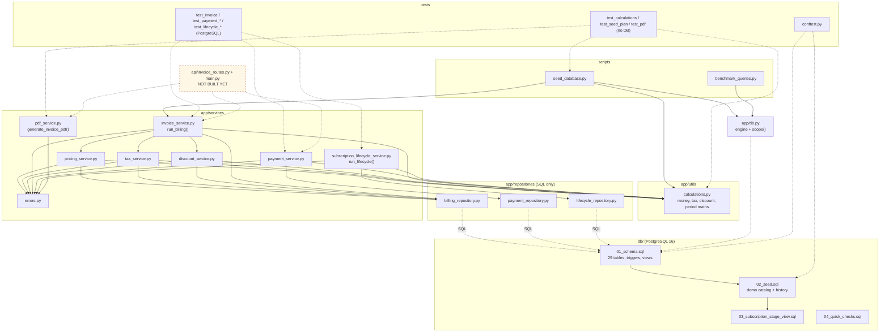
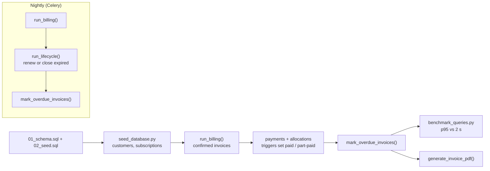

# File flow

Two views: (1) who imports whom, (2) what runs in what order. GitHub, GitLab and VS Code
(Markdown Preview Mermaid Support) render these.

## 1. Code dependencies (arrow = "imports / calls")

## 2. Runtime order

